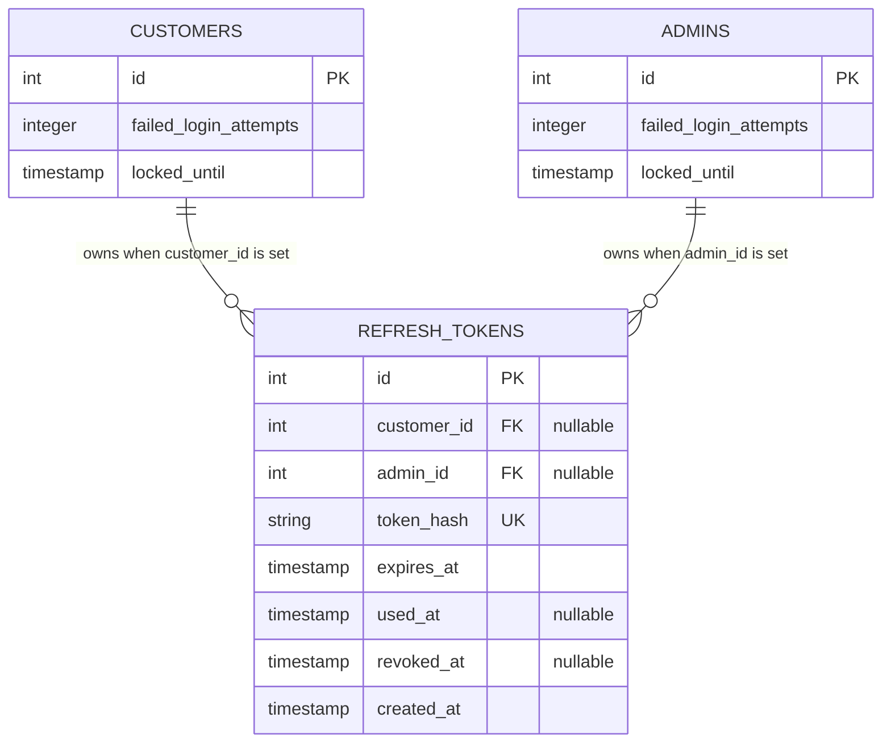

# Authentication ER Diagram

This diagram source documents the authentication-related portion of the database schema described in backend issue [#32](https://github.com/stackstormproject/backend/issues/32). Existing account attributes not relevant to authentication are omitted. The `customers` and `admins` identifiers retain the types defined by their respective account tables.

`customer_id` and `admin_id` are individually nullable. A database check constraint requires exactly one of them to be non-null for every refresh-token row. Both foreign keys cascade on update and delete. Only the SHA-256 hash of a refresh token is stored.

This is an authentication ER diagram source for incorporation into the full SDS; the full SDS PDF is not present in this repository.
